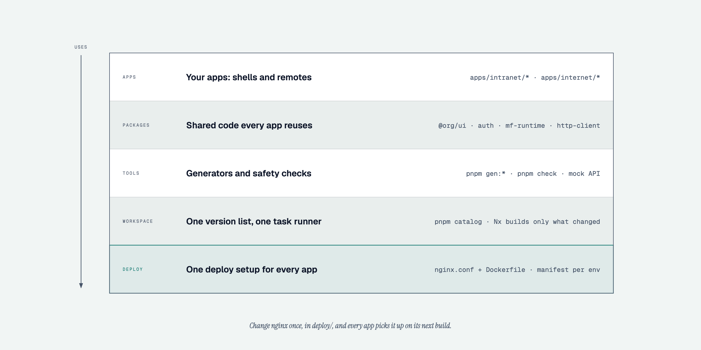

# Architecture

A pnpm + Nx monorepo of React microfrontends. Each **zone** (intranet, internet) has one
**shell** (host app) and any number of **remotes**. Every app is built and deployed on its own;
the shell loads remotes **at runtime** with Module Federation 2, from URLs in a per-environment
manifest.

## Decisions

| #   | Decision                                                                                                                       | Where it shows                                                    |
| --- | ------------------------------------------------------------------------------------------------------------------------------ | ----------------------------------------------------------------- |
| D1  | Monorepo: pnpm workspaces + Nx in package-based mode (Nx orchestrates; each app keeps its own `package.json` and build config) | `pnpm-workspace.yaml`, `nx.json`, `apps/*/*/package.json`         |
| D2  | Rspack + Module Federation 2 (`@module-federation/enhanced`), remotes registered at runtime                                    | `@org/rspack-config`, `@org/mf-runtime`                           |
| D3  | Vendors have no repo access: they deliver hosted builds against a published contract and the vendor kit                        | [external-modules.md](external-modules.md), `packages/vendor-kit` |
| D4  | Dependency tiers; core libraries have one version for everyone (pnpm catalog), exceptions are justified and expire             | [adding-dependencies.md](adding-dependencies.md), `pnpm check`    |
| D5  | No hybrid layer. Separate intranet and internet shells; public vs signed-in areas are route guards inside a shell              | `access:private` remotes, `<RequireAuth>`                         |
| D6  | Auth is provider-agnostic, backend session (BFF) pattern; the browser never handles tokens                                     | [auth-contract.md](auth-contract.md), `@org/auth`                 |
| D7  | Every app/package has its own `node_modules` (pnpm isolated layout, no hoisting)                                               | `nodeLinker: isolated`                                            |
| D8  | Frontend only. DevOps (Azure DevOps) gets a handoff doc and reference nginx/Dockerfile, no pipeline code                       | [devops-handoff.md](devops-handoff.md), `deploy/`                 |

Pinned versions and the reasons behind them: [toolchain.md](toolchain.md).

## Runtime


The plain-language picture ([standalone HTML](diagrams/1-runtime.html), [about the diagrams](diagrams/README.md)).
The sequence below is the technical detail.


1. The shell's `bootstrap.tsx` fetches `/mfe-manifest.json`. It is **not** part of the build:
   DevOps writes one per environment (`deploy/mfe-manifest.example.json`), so one build runs
   everywhere. Invalid → start-up error page; offline → connection message.
2. `initRemotes(manifest)` registers every remote with the Module Federation runtime.
3. Routes come from the shell's `remotes.json` (registry written by `pnpm gen:remote`): one nav
   entry and one splat route `/<remote>/*` each. The route renders `<RemoteApp>` (error boundary
   - Suspense + `loadRemote`), so a remote that fails to load shows `RemoteFallback` with
     "Try again" while the rest of the shell keeps working.
4. The remote's exposed `./App` renders its own routes **inside the shell's router** (react-router
   is a shared singleton) and receives host props: `basePath`, `user`, `settings`, the manifest's
   per-remote `props`.
5. Standalone (`pnpm dev` in a remote) the same feature code runs with its own router, theme
   and mock host props.

### Shared singletons (tier 1)

`react`, `react-dom`, `react-router`, `@org/ui`, `@org/auth` are shared with
`singleton: true, strictVersion: true` and the catalog version. The shell provides them; remotes
never download their own copy. A remote built against another version fails to load (fallback)
instead of running with two Reacts. Everything else is bundled per app.

### Theme, global styles, PWA

The shell owns the document: it imports the global styles, sets `data-theme` on `<html>`
(`ThemeProvider` from `@org/ui`) and registers the service worker. Remotes inherit the CSS
variables and use the shell's `ThemeProvider` through the shared `@org/ui`; they never import
global styles from their exposed module.

### Layouts belong to the apps

Each shell owns its layout (`src/layouts/ShellLayout/`: header, nav, colours), copied from a
starter by `pnpm gen:shell <zone> [--layout top|side]` and then edited like any other code of the
shell; a remote owns its standalone chrome (`src/layouts/StandaloneLayout/`). `@org/ui` holds
only building blocks (`SkipLink`, `Brand`, `ThemeToggle`, `useMenuDisclosure`, `useFitLayout`,
…). Two reasons:

- **Independence**: shells look and are structured differently (a blue staff portal with a
  sidebar, a white citizen site with a top nav) without options in shared code that every app
  would have to carry.
- **No all-app rebuild for a restyle**: `@org/ui` is a tier-1 singleton every app depends on, so
  any change to it affects every app (`pnpm -s apps --affected` lists them all, the pipeline
  rebuilds and redeploys them). A change in a shell's `ShellLayout` affects only that shell.

The shared parts are the ones that must behave the same everywhere (keyboard and screen reader
behaviour of the skip link and the Menu disclosure, the measured collapse, theme and session
state). See [ui-context.md](ui-context.md#layout-the-shell-owns-it).

How CSS is delivered: in development style-loader injects `<style>` elements (fast HMR); in
production every app ships extracted, content-hashed `.css` files. Loading a remote's exposed
module (or one of its lazy chunks) makes the remote's own chunk loader add
`<link rel="stylesheet">` for that chunk's CSS from the remote's origin and wait for it before
the code runs; a CSS file that fails to load fails the remote like a JS chunk (fallback with
retry). Nothing in the page needs inline styles, so the CSP has no `style-src 'unsafe-inline'`
([devops-handoff.md](devops-handoff.md#csp); details in [toolchain.md](toolchain.md)).

## Zones

|           | intranet                                                                            | internet                                                       |
| --------- | ----------------------------------------------------------------------------------- | -------------------------------------------------------------- |
| Shell     | `apps/intranet/shell-intranet`                                                      | `apps/internet/shell-internet`                                 |
| Dev ports | 3100 (shell), 3101–3189 apps; 3190–3199 dev tools (mock API 3190, mock vendor 3191) | 3200 (shell), 3201–3289 apps; 3290–3299 dev tools (3290, 3291) |
| Users     | staff (SSO via the BFF)                                                             | public + signed-in citizens (Singpass via the BFF)             |
| Sharing   | only `packages/*`                                                                   | only `packages/*`                                              |

Zones never share remotes, and remotes never import remotes or shells. Enforced by
`pnpm check` (check-apps) and ESLint (Nx module boundaries); see [guardrails.md](guardrails.md).

### Dev tool servers

Dev-only servers (mock API, mock vendor, a vendor's demo server, a fake BFF, …) live in
`tools/<name>` and take a port from their zone's **tools range** (the last ten ports: intranet
3190–3199, internet 3290–3299). Which tool gets which port is declared once, in the root
`package.json`, as an **offset** into that range:

```json
"mfe": {
  "tools": {
    "mockApi": { "offset": 0, "package": "@org/mock-api" },
    "mockVendor": { "offset": 1, "package": "@org/mock-vendor" }
  }
}
```

Port = the zone's first tools port + offset (`mockVendor`: 3191 intranet, 3291 internet).
Everything reads this one declaration: the servers and generators through
`toolPort(zone, '<tool>')` (`@org/scripts/zones`), the e2e config through `TOOL_PORTS`
(`@org/playwright-config/zone`), and `pnpm check` validates it (unique offsets 0–9, existing
package; rules `tool-*` in [guardrails.md](guardrails.md)).

#### Adding a dev-tool server

Example: a vendor's demo server for the `payments` adapter in the internet zone.

1. Create the package `tools/example-vendor/package.json`:

   ```json
   {
     "name": "@org/example-vendor",
     "private": true,
     "type": "module",
     "scripts": {
       "serve:intranet": "node bin/serve.js --zone intranet",
       "serve:internet": "node bin/serve.js --zone internet"
     },
     "nx": {
       "tags": ["type:tool"],
       "targets": {
         "serve:intranet": { "continuous": true, "cache": false },
         "serve:internet": { "continuous": true, "cache": false }
       }
     },
     "dependencies": { "@org/scripts": "workspace:*" }
   }
   ```

   (Only the zones it serves need a `serve:<zone>` script.)

2. Pick a free offset (template: 0 and 1 are taken, 2–9 are free) and declare it in the root
   `package.json`:
   `"exampleVendor": { "offset": 2, "package": "@org/example-vendor" }` under `mfe.tools`.
3. Read the port in the server, never hardcode it:

   ```js
   import { toolPort } from '@org/scripts/zones';
   const port = toolPort(zone, 'exampleVendor'); // intranet 3192, internet 3292
   ```

4. Start it with the zone: add it to `nx.targets.dev.dependsOn` of the app that needs it (here
   `apps/internet/payments/package.json`, next to the mock API entry):
   `{ "projects": ["@org/example-vendor"], "target": "serve:internet" }`. `pnpm dev:internet`
   (and the e2e `webServer`) then starts it once.
5. Point the dev manifest at it (`mfe-manifest.dev.json`, e.g. the adapter's `props.vendor.url`
   `http://localhost:3292/mount.js`). The e2e global setup already waits for local vendor
   URLs; for any other endpoint pass `createZoneConfig({ extraHealthUrls: [...] })` in the
   shell's `playwright.config.ts`.
6. `pnpm install && pnpm check`: a duplicate or out-of-range offset, or a `package` that does not
   exist, fails `check-apps` with the free offsets in the message.

## Access: public and private remotes

A remote generated with `--private` (tag `access:private`) is wrapped in `<RequireAuth>` by the
shell: signed out, the user sees a sign-in prompt and the remote's files are **not downloaded**.
That is a UX boundary; the BFF/APIs enforce authorisation on every request.

## Auth (D6)

```
shell ──GET sessionUrl──▶ BFF ──▶ IdP (Singpass / SSO)
      ◀── { user, csrfToken, expiresAt } | 401      (HttpOnly session cookie)
```

The browser only asks the BFF who is signed in, navigates to the BFF to sign in and posts to it
to sign out. `@org/auth` (tier-1 singleton) gives the shell and every remote the same session
state. Details: [auth-contract.md](auth-contract.md).

## External (vendor) modules (D3)

UI built outside this repo (vendor products, other frameworks, other React majors) integrates
through an **adapter remote** (`pnpm gen:remote <zone> <name> --external`) that renders
`<ExternalModule>`: it loads the vendor bundle from the manifest (`props.vendor`: url, format,
integrity) and drives the mount contract `mount(el, props) → { update, unmount }`. Untrusted code
goes in an iframe. Details: [external-modules.md](external-modules.md).

## Repository layout



[Standalone HTML](diagrams/2-layers.html) · [about the diagrams](diagrams/README.md)

```
apps/<zone>/<name>/      apps (generated); shells hold the zone's e2e suite in e2e/
packages/                shared code: ui, design-tokens, mf-runtime, auth, http-client, pwa,
                         rspack-config, jest-config, playwright-config, eslint/prettier/tsconfig,
                         vendor-kit
tools/                   generators, scripts (check, apps, dev, e2e, validate-manifest, preview),
                         mock-api, mock-vendor (dev only; ports in root package.json mfe.tools)
deploy/                  nginx template, Dockerfile, example per-environment manifest
docs/                    this documentation (diagrams and their generator in docs/diagrams/)
```

## Build and deploy

- `pnpm build` builds every app into its own `dist/` (`pnpm -s apps --json` lists them with
  `distDir`). A remote's `dist/` contains `mf-manifest.json`, `remoteEntry.js` and hashed chunks
  (`.js` and extracted `.css`); a shell's contains `index.html`, hashed chunks and the service
  worker, but **no** `mfe-manifest.json`.
- Each app is served as static files (one nginx image per app from `deploy/Dockerfile`), with
  SPA fallback, `no-cache` for entry files and long-lived caching for hashed chunks.
- The shell's `/mfe-manifest.json` is written per environment at deploy time; changing a remote
  URL, a vendor version or the BFF location is a manifest change, not a rebuild.

See [devops-handoff.md](devops-handoff.md).
