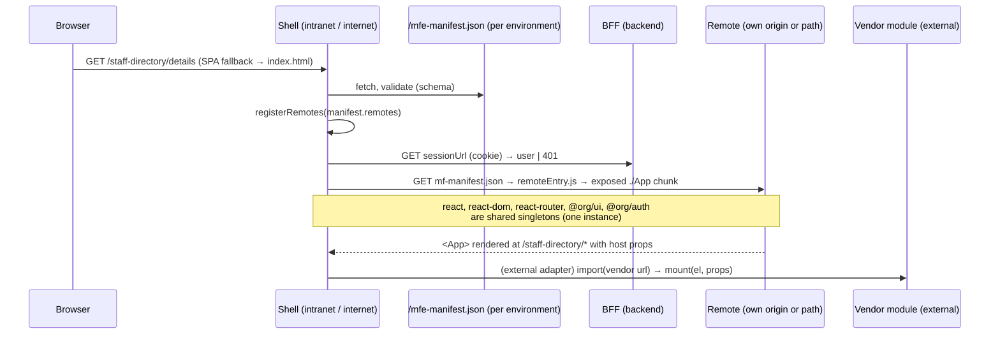

# Architecture

A pnpm + Nx monorepo of React microfrontends. Each **zone** (intranet, internet) has one
**shell** (host app) and any number of **remotes**. Every app is built and deployed on its own;
the shell loads remotes **at runtime** with Module Federation 2, from URLs in a per-environment
manifest.

## Decisions

| #   | Decision                                                                                                                       | Where it shows                                                    |
| --- | ------------------------------------------------------------------------------------------------------------------------------ | ----------------------------------------------------------------- |
| D1  | Monorepo: pnpm workspaces + Nx in package-based mode (Nx orchestrates; each app keeps its own `package.json` and build config) | `pnpm-workspace.yaml`, `nx.json`, `apps/*/*/package.json`         |
| D2  | Rspack + Module Federation 2 (`@module-federation/enhanced`), remotes registered at runtime                                    | `@org/rspack-config`, `@org/mf-runtime`                           |
| D3  | Vendors have no repo access: they deliver hosted builds against a published contract and the vendor kit                        | [external-modules.md](external-modules.md), `packages/vendor-kit` |
| D4  | Dependency tiers; core libraries have one version for everyone (pnpm catalog), exceptions are justified and expire             | [adding-dependencies.md](adding-dependencies.md), `pnpm check`    |
| D5  | No hybrid layer. Separate intranet and internet shells; public vs signed-in areas are route guards inside a shell              | `access:private` remotes, `<RequireAuth>`                         |
| D6  | Auth is provider-agnostic, backend session (BFF) pattern; the browser never handles tokens                                     | [auth-contract.md](auth-contract.md), `@org/auth`                 |
| D7  | Every app/package has its own `node_modules` (pnpm isolated layout, no hoisting)                                               | `nodeLinker: isolated`                                            |
| D8  | Frontend only. DevOps (Azure DevOps) gets a handoff doc and reference nginx/Dockerfile, no pipeline code                       | [devops-handoff.md](devops-handoff.md), `deploy/`                 |

Pinned versions and the reasons behind them: [toolchain.md](toolchain.md).

## Runtime



1. The shell's `bootstrap.tsx` fetches `/mfe-manifest.json`. It is **not** part of the build:
   DevOps writes one per environment (`deploy/mfe-manifest.example.json`), so one build runs
   everywhere. Invalid → start-up error page; offline → connection message.
2. `initRemotes(manifest)` registers every remote with the Module Federation runtime.
3. Routes come from the shell's `remotes.json` (registry written by `pnpm gen:remote`): one nav
   entry and one splat route `/<remote>/*` each. The route renders `<RemoteApp>` (error boundary
   - Suspense + `loadRemote`), so a remote that fails to load shows `RemoteFallback` with
     "Try again" while the rest of the shell keeps working.
4. The remote's exposed `./App` renders its own routes **inside the shell's router** (react-router
   is a shared singleton) and receives host props: `basePath`, `user`, `settings`, the manifest's
   per-remote `props`.
5. Standalone (`pnpm dev` in a remote) the same feature code runs with its own router, theme
   and mock host props.

### Shared singletons (tier 1)

`react`, `react-dom`, `react-router`, `@org/ui`, `@org/auth` are shared with
`singleton: true, strictVersion: true` and the catalog version. The shell provides them; remotes
never download their own copy. A remote built against another version fails to load (fallback)
instead of running with two Reacts. Everything else is bundled per app.

### Theme, global styles, PWA

The shell owns the document: it imports the global styles, sets `data-theme` on `<html>`
(`ThemeProvider` from `@org/ui`) and registers the service worker. Remotes inherit the CSS
variables and use the shell's `ThemeProvider` through the shared `@org/ui`; they never import
global styles from their exposed module.

## Zones

|           | intranet                       | internet                                           |
| --------- | ------------------------------ | -------------------------------------------------- |
| Shell     | `apps/intranet/shell-intranet` | `apps/internet/shell-internet`                     |
| Dev ports | 3100 (shell), 3101–3199        | 3200 (shell), 3201–3299                            |
| Users     | staff (SSO via the BFF)        | public + signed-in citizens (Singpass via the BFF) |
| Sharing   | only `packages/*`              | only `packages/*`                                  |

Zones never share remotes, and remotes never import remotes or shells. Enforced by
`pnpm check` (check-apps) and ESLint (Nx module boundaries); see [guardrails.md](guardrails.md).

## Access: public and private remotes

A remote generated with `--private` (tag `access:private`) is wrapped in `<RequireAuth>` by the
shell: signed out, the user sees a sign-in prompt and the remote's files are **not downloaded**.
That is a UX boundary; the BFF/APIs enforce authorisation on every request.

## Auth (D6)

```
shell ──GET sessionUrl──▶ BFF ──▶ IdP (Singpass / SSO)
      ◀── { user, csrfToken, expiresAt } | 401      (HttpOnly session cookie)
```

The browser only asks the BFF who is signed in, navigates to the BFF to sign in and posts to it
to sign out. `@org/auth` (tier-1 singleton) gives the shell and every remote the same session
state. Details: [auth-contract.md](auth-contract.md).

## External (vendor) modules (D3)

UI built outside this repo (vendor products, other frameworks, other React majors) integrates
through an **adapter remote** (`pnpm gen:remote <zone> <name> --external`) that renders
`<ExternalModule>`: it loads the vendor bundle from the manifest (`props.vendor`: url, format,
integrity) and drives the mount contract `mount(el, props) → { update, unmount }`. Untrusted code
goes in an iframe. Details: [external-modules.md](external-modules.md).

## Repository layout

```
apps/<zone>/<name>/      apps (generated); shells hold the zone's e2e suite in e2e/
packages/                shared code: ui, design-tokens, mf-runtime, auth, http-client, pwa,
                         rspack-config, jest-config, playwright-config, eslint/prettier/tsconfig,
                         vendor-kit
tools/                   generators, scripts (check, apps, e2e, validate-manifest, preview),
                         mock-vendor (dev only)
deploy/                  nginx template, Dockerfile, example per-environment manifest
docs/                    this documentation
```

## Build and deploy

- `pnpm build` builds every app into its own `dist/` (`pnpm -s apps --json` lists them with
  `distDir`). A remote's `dist/` contains `mf-manifest.json`, `remoteEntry.js` and hashed chunks;
  a shell's contains `index.html`, hashed chunks and the service worker, but **no**
  `mfe-manifest.json`.
- Each app is served as static files (one nginx image per app from `deploy/Dockerfile`), with
  SPA fallback, `no-cache` for entry files and long-lived caching for hashed chunks.
- The shell's `/mfe-manifest.json` is written per environment at deploy time; changing a remote
  URL, a vendor version or the BFF location is a manifest change, not a rebuild.

See [devops-handoff.md](devops-handoff.md).
