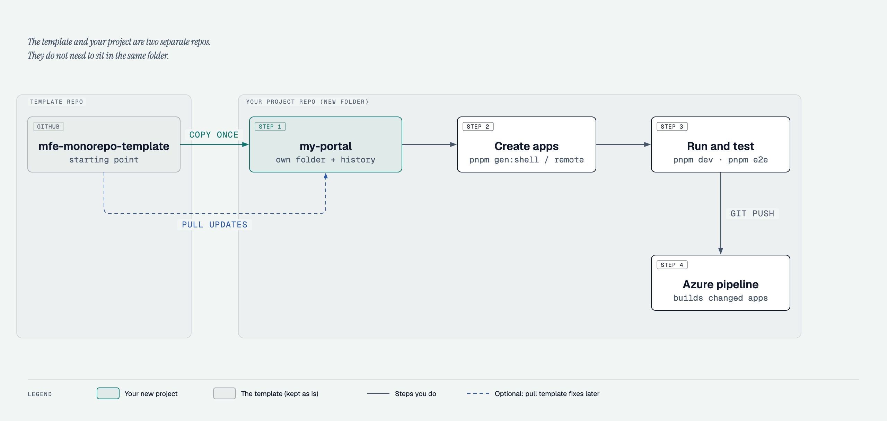

# Getting started

From a fresh clone to a running zone with tests. Commands run from the repository root unless
noted. Takes about ten minutes, most of it downloads.

## 1. Prerequisites

- **Node.js 24** (the version is in `.nvmrc`). With nvm: `nvm install 24` once.
- **Corepack** (ships with Node 24) provides the exact pnpm version from `package.json`
  (`packageManager`). Do not install pnpm globally with npm.
- Git. macOS, Linux or WSL2.

## 2. Clone and install



The template and your project are separate repos: you copy the template once and from then on
the copy is your project. Your project does not need to sit next to the template on disk. You
can still pull template fixes later: see
[Keeping up with template fixes](#keeping-up-with-template-fixes-optional).
([Standalone HTML](diagrams/3-new-project.html), [about the diagrams](diagrams/README.md).)

```sh
git clone <template-url> my-portal
cd my-portal
nvm use               # Node 24 from .nvmrc
corepack enable       # once per Node installation: puts the pinned pnpm on the PATH
pnpm install
```

Check that the empty template is green:

```sh
pnpm check            # guardrails (dependency tiers, app metadata)
pnpm lint
pnpm typecheck
pnpm test
```

`apps/` is empty: the template ships shared packages, tools and docs only.

Local settings live in `.env` files (git-ignored), next to a committed `.env.example` that lists
every variable: after generating a shell, `cp apps/<zone>/.env.example apps/<zone>/.env` only if
you want to change a default (for instance `API_UPSTREAM` to develop against a real UAT API).
Nothing is needed for the mock API. See [configuration.md](configuration.md).

## 3. Create apps

Each zone (`intranet`, `internet`) has one or more shells and any number of remotes. Create
the shell first:

```sh
pnpm gen:shell intranet                                 # --layout side: sidebar starter layout
pnpm gen:remote intranet staff-directory                # public remote
pnpm gen:remote intranet leave-requests --private       # sign-in required
pnpm gen:remote intranet it-helpdesk --external         # adapter for a vendor module
pnpm install
```

A zone with several shells (each under its own base path, with its own layout and sign-in):

```sh
pnpm gen:shell internet citizen --base-path /citizen                  # / redirects here
pnpm gen:shell internet business --base-path /business --layout side
pnpm gen:remote internet announcements --shell citizen,business       # listed by both
pnpm gen:remote internet licences --shell business
```

Each shell gets the next free shell port (3101, 3102, …), each remote the next free remote port
(3110, 3111, …), a route in the shell
(`/staff-directory/*`) and an entry in the shell's dev manifest. Details:
[adding-an-app.md](adding-an-app.md).

## 4. Run a zone

```sh
pnpm dev:intranet
```

Open http://localhost:3100: the zone's dev proxy, which serves every shell of the zone under its
base path (a zone with shells at `/citizen` and `/business` redirects `/` to the default one).
The shell loads every remote from its own dev server at runtime.
"Sign in" uses the development mock (no backend needed). The remotes' demo feature loads data
from the zone's **mock API** (`tools/mock-api`, http://localhost:3190/api, started
automatically). Pages call `<base path>/api/...` on the proxy origin (`settings.apiBaseUrl` in
the shell's generated `mfe-manifest.dev.json`, from `mfe.devManifest` in its `package.json`); the
proxy forwards it to `API_UPSTREAM`, by default that mock API. To change it (e.g. a real UAT API),
copy the zone's `.env.example` to `.env` and edit it, see [configuration.md](configuration.md).
`it-helpdesk` mounts the mock vendor module (started automatically on port 3191). Stop with
Ctrl+C.

The other zone can run at the same time (`pnpm dev:internet`: proxy on 3200, mock API 3290,
mock vendor 3291): every zone has its own port range (proxy x00, shells x01–x09, remotes
x10–x89, tools x90–x99).

One remote on its own (standalone mode, mock host props):

```sh
pnpm --filter @org/intranet-staff-directory dev        # http://localhost:3110
```

## 5. Test

```sh
pnpm test                                                        # unit tests, every project
pnpm --filter @org/shell-intranet exec playwright install chromium   # once per machine
pnpm e2e:intranet                                                # zone e2e + axe (light + dark)
```

Components: `pnpm storybook` shows every `@org/ui` component in light and dark
(http://localhost:3193); `pnpm test:ui` runs axe and screenshot tests of all of them
([packages/ui/README.md](../packages/ui/README.md)).

`pnpm e2e:intranet` starts `pnpm dev:intranet` itself (or reuses it if it is already running),
tests every remote in the shell and standalone, on desktop and 375 px, and stops the servers
afterwards. `pnpm e2e` runs every zone, one after the other. See [testing.md](testing.md).

## 6. Build

```sh
pnpm build                                   # every app → apps/<zone>/<name>/dist
pnpm -s apps                                 # what was built, with ports
```

Look at a production build locally (the shell needs a manifest; the dev one works):

```sh
pnpm --filter @org/intranet-staff-directory preview &
pnpm --filter @org/shell-intranet preview --manifest mfe-manifest.dev.json
```

Production uses the per-environment manifest and nginx from `deploy/`
([devops-handoff.md](devops-handoff.md)). Note: the dev manifest's mock sign-in is disabled in
production builds, so private remotes show "Sign-in unavailable" in this preview.

## 7. Before you push

```sh
pnpm check && pnpm lint && pnpm typecheck && pnpm test && pnpm format:check
pnpm build && pnpm e2e
pnpm test:ui                                 # when packages/ui changed
```

CI runs the same gates ([devops-handoff.md](devops-handoff.md)).

## Daily commands

| Command                                                                                                                                                   | What                                                                                                  |
| --------------------------------------------------------------------------------------------------------------------------------------------------------- | ----------------------------------------------------------------------------------------------------- |
| `pnpm dev:<zone>`                                                                                                                                         | every shell + remote of the zone, dev proxy on 3100 / 3200                                            |
| `pnpm --filter <package> dev`                                                                                                                             | one app (`pnpm -s apps` lists package names)                                                          |
| `pnpm gen:shell <zone> [<name>] [--base-path /x] [--layout top\|side]` / `pnpm gen:remote <zone> <name> [--shell <s>] [--private] [--state] [--external]` | new apps (`--layout`: which starter layout the shell copies; `--shell`: which shells list the remote) |
| `pnpm --filter <package> add <dep>`                                                                                                                       | add a dependency ([adding-dependencies.md](adding-dependencies.md))                                   |
| `pnpm lint` / `typecheck` / `test` / `build`                                                                                                              | all projects (Nx, cached)                                                                             |
| `pnpm e2e` / `pnpm e2e:<zone>`                                                                                                                            | zone e2e suites                                                                                       |
| `pnpm storybook` / `pnpm build-storybook` / `pnpm test:ui`                                                                                                | `@org/ui` components (dev server on 3193 / static build / axe + screenshots)                          |
| `pnpm -s apps [--zone=<zone>] [--affected --base=<sha>] [--json]`                                                                                         | list apps (CI matrix)                                                                                 |
| `pnpm format`                                                                                                                                             | Prettier                                                                                              |

## Next

- [architecture.md](architecture.md): how shells, remotes, manifest, auth and vendors fit
- [coding-conventions.md](coding-conventions.md) and [ui-context.md](ui-context.md) before writing code
- [project-overview.md](project-overview.md): fill in your product
- `AGENTS.md` if you work with AI coding agents

## Keeping up with template fixes (optional)

Your project keeps the template's history, so you can merge later template fixes. Once, in your
project:

```sh
git remote rename origin template          # if you cloned the template
# or: git remote add template <template-url>   (if you started another way)
git remote add origin <your-project-url>   # your own repo
git push -u origin main
```

Then, whenever you want the template's fixes:

```sh
git fetch template
git merge template/main
pnpm install && pnpm check && pnpm lint && pnpm typecheck && pnpm test
```

On conflicts: the template wins for `packages/`, `tools/` and `docs/` (change shared code in the
template, not in your copy); your side wins for `apps/` and your own files
(`docs/project-overview.md`, manifests, pipeline settings).

Alternative to cloning: GitHub's **Use this template** button creates your repo in one step,
but without the template's history; the first `git merge template/main` then needs
`--allow-unrelated-histories` and resolves every shared file once.

## Troubleshooting

| Symptom                                                         | Fix                                                                                                                  |
| --------------------------------------------------------------- | -------------------------------------------------------------------------------------------------------------------- |
| `pnpm: command not found` or a different pnpm version           | `corepack enable`; a `packageManager` field in a parent folder (e.g. `~/package.json`) can confuse Corepack          |
| `ERR_PNPM_IGNORED_BUILDS` after adding a dependency             | the package has an install script: decide in `allowBuilds` (`pnpm-workspace.yaml`), see [toolchain.md](toolchain.md) |
| a remote shows "unavailable" in the shell                       | is its dev server running? `pnpm dev:<zone>` starts all; check the shell's `mfe-manifest.dev.json` port              |
| changed `webpack.config.js` or a shared config, nothing happens | restart the dev server (webpack-dev-server does not reload config files)                                             |
| e2e: "Executable doesn't exist"                                 | `pnpm --filter @org/shell-<zone> exec playwright install chromium`                                                   |
| e2e: "Not responding after 180 s"                               | a port is taken by a stale server (`lsof -i :3110`) or a remote fails to compile (`pnpm dev:<zone>` shows why)       |
| `pnpm check` fails                                              | every message names the fix; [guardrails.md](guardrails.md)                                                          |
